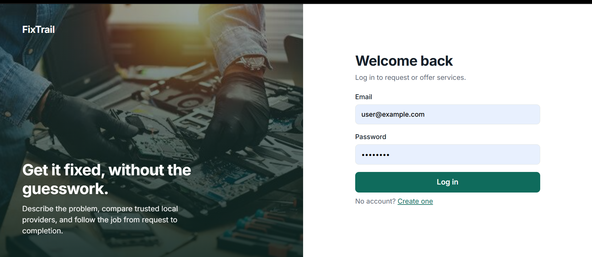
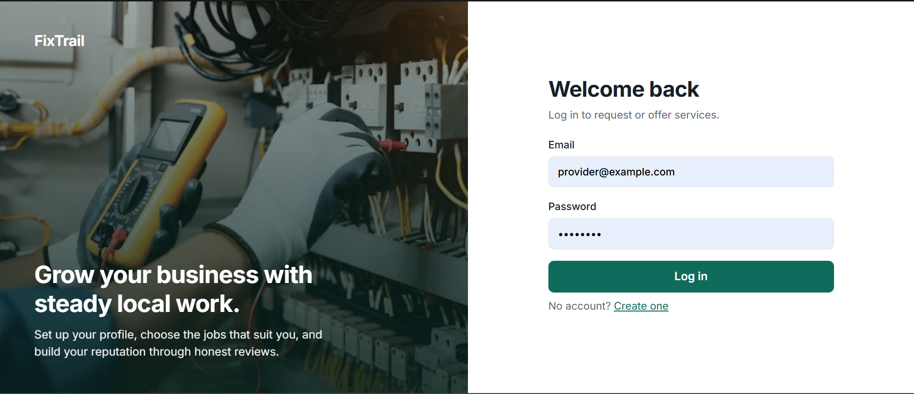
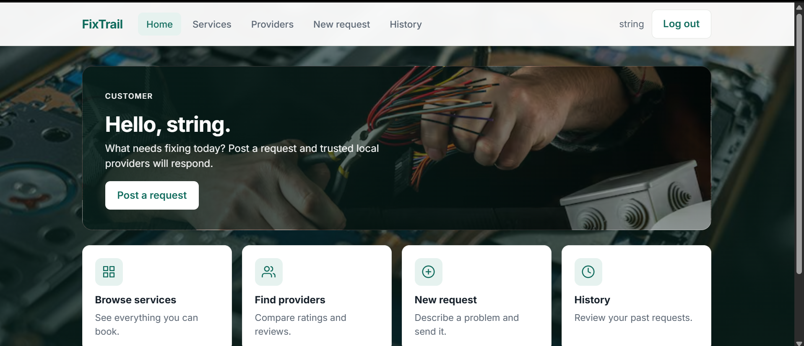
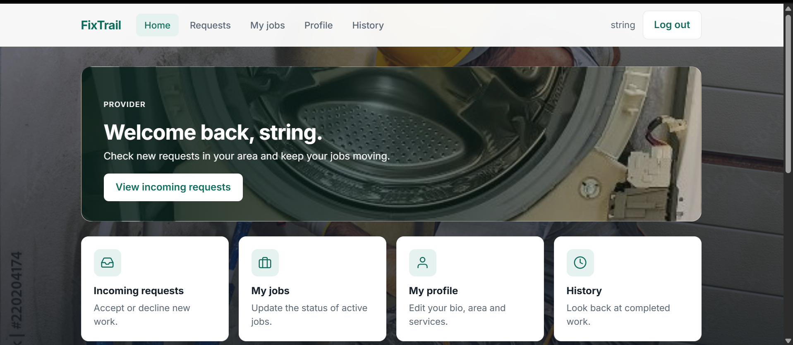
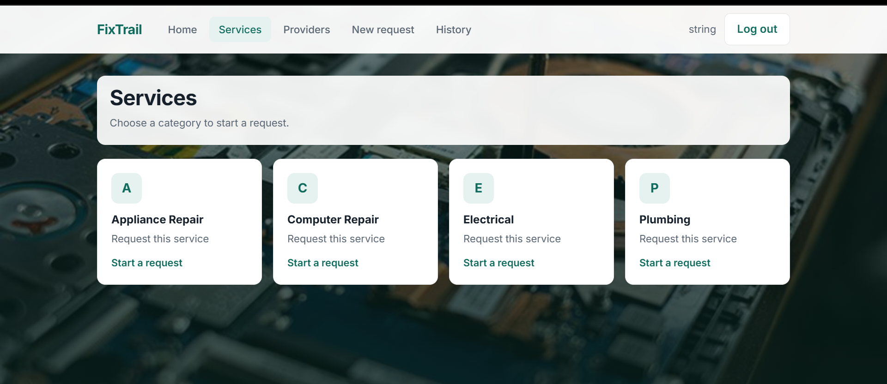
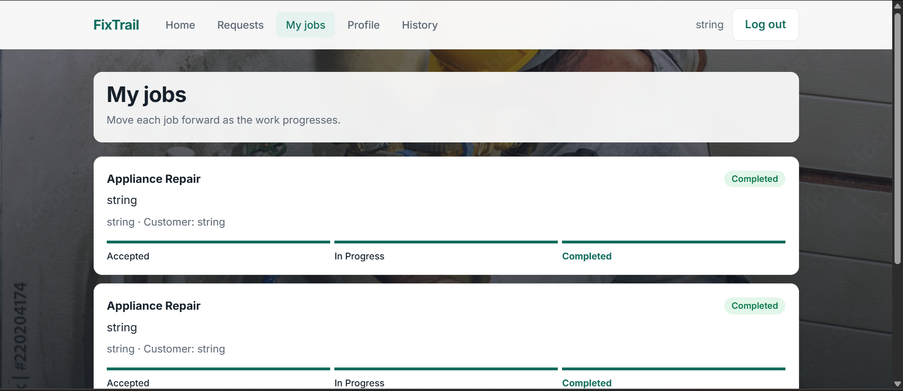

# FixTrail

FixTrail is a service marketplace. Customers post problems they need fixed, and local service providers browse, accept and complete those jobs. Customers can then rate the provider, and ratings build each provider's reputation.

This repository is the frontend (React and TypeScript). It talks to the FastAPI backend in a separate repository: [fixtrail-backend](https://github.com/Grooci/fixtrail-backend).

> Built as part of the Zynvex Solutions Internship (Batch 4).

**Live demo:** ADD-DEPLOYED-FRONTEND-LINK
**API:** ADD-DEPLOYED-BACKEND-LINK

## Progress

| Module | Focus | Status |
| ------ | ----- | ------ |
| 1 | Authentication flows, core data model, wireframes | Done |
| 2 | Frontend foundation: routing, auth, role guards | Done |
| 3 | Customer flows: categories, request form, request history | Done |
| 4 | Provider flows: profile, browse requests, accept/decline, status tracking | Done |
| 5 | Dashboards, ratings and reviews, history, design polish, deployed demo | Done |

## Features

**Customers**
- Register and log in as a customer
- Browse service categories and start a request from any of them
- Post a request with a description, location and optional photo
- Compare providers by category, rating and reviews
- Dashboard with request counts by status and recent activity
- Rate a provider after a job is completed
- Full request history with status filters, sorting and paging

**Providers**
- Register and log in as a provider, then set up a profile (bio, service area, categories, availability)
- Browse open requests in their categories, then accept or decline them
- Move accepted jobs through In Progress to Completed
- Dashboard with open requests, active and completed jobs, average rating and recent reviews
- Full job history with status filters, sorting and paging

**General**
- Role-based route protection
- Separate look for customers and providers
- Loading, empty and error states on every page

## Tech stack

- React 19 and TypeScript
- Vite
- React Router
- FastAPI backend with PostgreSQL (see the backend repository)
- Cloudinary for request photo uploads
- Figma for wireframes

## Getting started

You need the backend running first. Follow the setup steps in the [backend repository](https://github.com/Grooci/fixtrail-backend).

```
git clone https://github.com/Grooci/fixtrail-frontend.git
cd fixtrail-frontend
npm install
npm run dev
```

Open the local address shown in the terminal (usually http://localhost:5173).

### Environment variables

Create a `.env` file in the project root:

```
VITE_API_URL=http://127.0.0.1:8000
```

If `VITE_API_URL` is not set, the app defaults to `http://127.0.0.1:8000`.

## Trying it out

There are no built-in demo accounts. To see the full flow:

1. Register a **provider** account and complete the profile (choose at least one category).
2. Register a **customer** account in a second browser or a private window and post a request in one of those categories.
3. As the provider, open Requests and accept it, then move the job to In Progress and Completed.
4. As the customer, open the dashboard and rate the completed job.
5. Check the provider's dashboard and the Providers page for the new rating.

## Pages

| Path | Who | Purpose |
| ---- | --- | ------- |
| `/login`, `/register` | Everyone | Sign in or create an account |
| `/customer` | Customer | Home and dashboard |
| `/categories` | Customer | Service categories |
| `/providers` | Customer | Provider list with ratings and reviews |
| `/requests/new` | Customer | Post a request |
| `/provider` | Provider | Home and dashboard |
| `/provider/profile` | Provider | Profile and categories |
| `/provider/requests` | Provider | Open requests |
| `/provider/jobs` | Provider | Active jobs and status updates |
| `/history` | Both | Request or job history |

## Project structure

```
src/
  components/   Shared UI: AppLayout, AuthLayout, RatingModal, Stars, StatusBadge, Icon
  pages/        One file per screen
  routes/       ProtectedRoute (role-based access)
  services/     API calls to the backend (apiClient, auth, dashboard, history, reviews, providers, requests)
  types/        Shared TypeScript types
public/
  images/       Background and hero photos
```

## Screenshots








## Author
Daniella