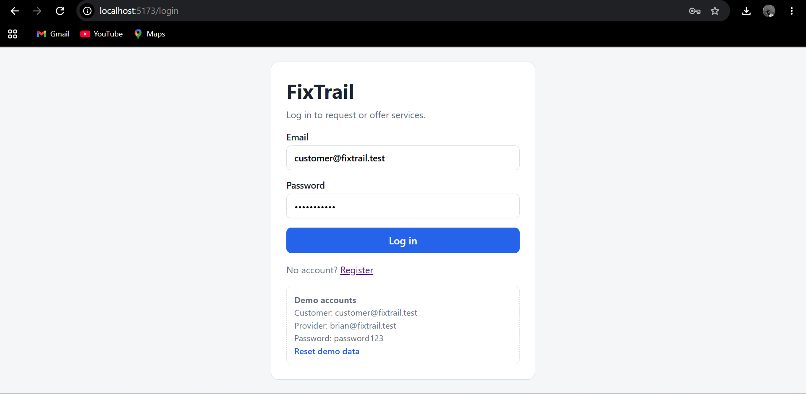
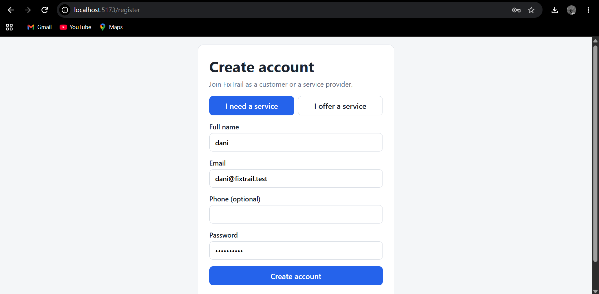
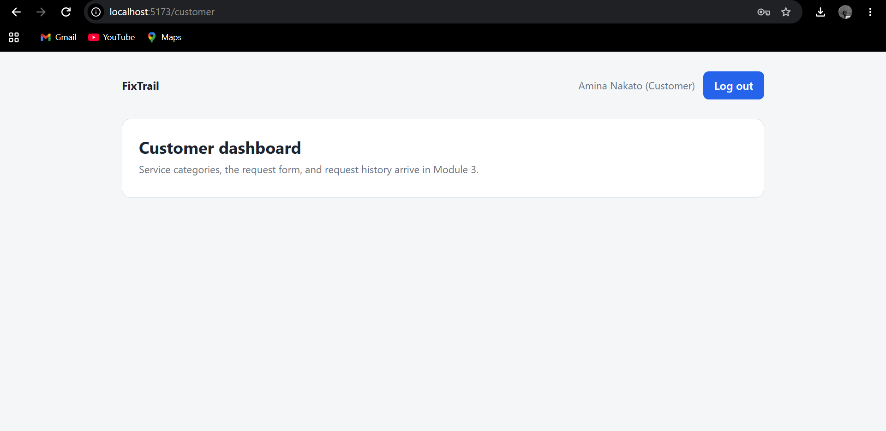
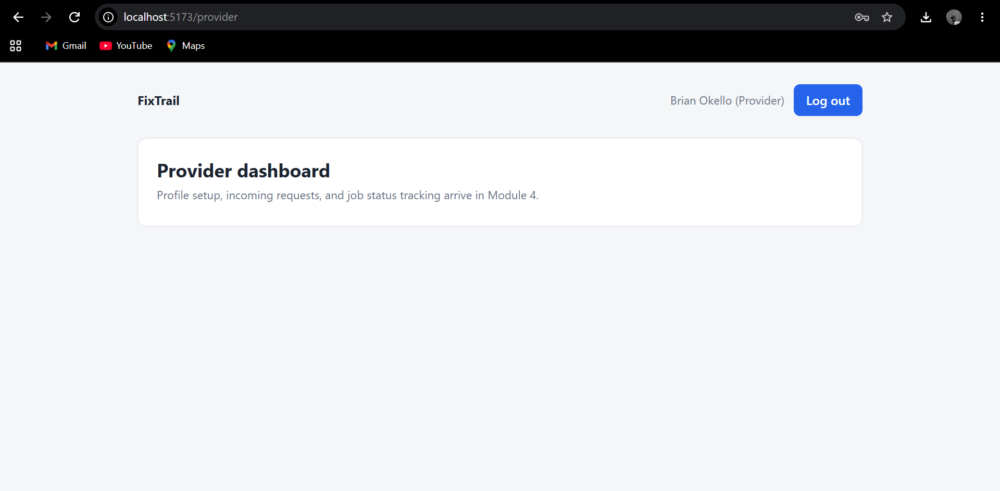

# FixTrail
FixTrail is a service marketplace where customers post problems they need fixed and service providers browse, accept, and complete those jobs. This repository holds the frontend, built with React and TypeScript.

> Built as part of the Zynvex Solutions Frontend Internship (Batch 4).

## Progress
| Module | Focus | Status |
| --- | --- | --- |
| 1 | Authentication flows, core data model, Figma wireframes | Done |
| 2 | Frontend foundation: routing, mock auth, role guards, seed data | Done |
| 3 | Customer flows: categories, request form, request history | Planned |
| 4 | Provider flows: profile, browse requests, accept/decline, status tracking | Planned |
| 5 | Dashboards, ratings and reviews, polish, deployed demo | Planned |

Module 1's backend work lives in a separate repository: [fixtrail-backend] https://github.com/Grooci/fixtrail-backend

## Features so far
- Customer and provider registration and login
- Role-based route protection (customers and providers see different areas)
- Mock session stored in localStorage
- Seeded demo data (users, categories, providers, requests, reviews)
- "Reset demo data" button on the login page

## Tech stack
- React 19 and TypeScript
- Vite
- React Router
- localStorage for mock data persistence
- Figma for wireframes
- Git and GitHub

## Getting started
```bash
git clone ADD-FRONTEND-REPO-LINK-HERE
cd fixtrail-frontend
npm install
npm run dev
```

Then open the local address shown in the terminal (usually http://localhost:5173).

## Demo accounts
| Role | Email | Password |
| --- | --- | --- |
| Customer | customer@fixtrail.test | password123 |
| Provider | brian@fixtrail.test | password123 |

These are mock credentials for demonstration only.

## How it works without a backend
All data is loaded from `src/data/seed.json` into the browser's localStorage the first time the app runs. Service files in `src/services/` (such as `authService.ts`) read and write that data, so the screens behave as if they were talking to a server. Because everything is stored in the browser:
- Data is only visible in the browser where it was created
- Clearing browser data resets the app to the seed data
- Passwords are stored in plain text, which is acceptable for a demo only

## Project structure
```
src/
  components/   Reusable UI pieces (added in later modules)
  data/         Seed data (seed.json)
  pages/        Login, Register, Customer and Provider dashboards
  routes/       ProtectedRoute (role-based access)
  services/     storage.ts and authService.ts (localStorage layer)
  types/        Shared TypeScript types
```

## Screenshots
Add screenshots to `docs/screenshots/` and link them here.






## Author
Daniella
